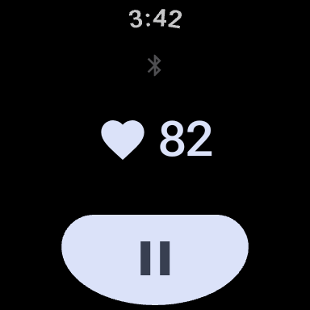
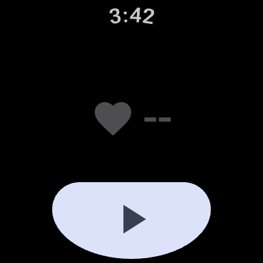
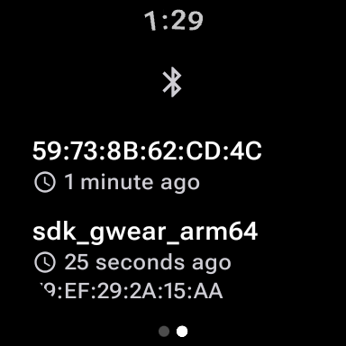

#  Wristbeat

[](https://github.com/nikosavola/Wristbeat/actions/workflows/ci.yml)
[](https://codecov.io/gh/nikosavola/Wristbeat)
[](https://sonarcloud.io/summary/new_code?id=nikosavola_Wristbeat)
[](LICENSE)
[](https://0ver.org)

A Wear OS app that broadcasts the watch's heart rate as a standard Bluetooth heart rate sensor.
Gym equipment, bike computers, rowing machines and phone apps pair with it the way they pair with a
chest strap.

There is nothing else in it. One button, no account, no history, no companion app, and no network
access of any kind.

## Screens

The session screen is the reading beside a heart, the receiver count beside a receiver glyph, and
play and pause across the bottom edge.





The receivers screen lists everyone reading, under the same glyph as the count. A receiver that
paired first shows the name the platform knows it by, the rest show their address, and each row says
how long ago it connected.



## What it does

- Holds a GATT server with the Bluetooth SIG **Heart Rate Service** (`0x180D`): the Heart Rate
  Measurement characteristic (`0x2A37`, read and notify) and Body Sensor Location (`0x2A38`,
  reported as wrist).
- Advertises the service UUID, so a receiver finds it by service rather than by name.
- Broadcasts what the watch's own optical sensor reads. Zero and unreliable readings are never sent.
- Runs in a foreground service, so it keeps going with the screen off.
- While it runs, a notification and a chip on the watch face show the heart rate and the receiver
  count. A session is meant to be left running, and the watch keeps saying so.
- Nothing on screen is a word. Every state is an icon, so there is nothing to translate.
- An on-device assistant can start and stop a session through two
  [AppFunctions](https://developer.android.com/ai/appfunctions), and cannot put the watch into a
  state the button could not reach. The API is still alpha, so no shipping assistant can call it yet.
- A session is cheap to leave running: balanced advertising, a notification paced to once per five
  seconds, no wakelock, and the sensor asked for its slowest rate.

## From the wrist

The button plays and pauses, and buzzes to say which way it went. Turn the bezel, swipe, or tap the
receiver count to flip between the session page and the receivers page. Every control is one
screen-reader node that says what it is and what pressing it does, and the touch targets measure
48dp at every font size.

## Using it

Press play. The first time asks for three permissions: nearby devices, heart rate, notifications.
The last one is optional, and refusing it only hides the notification. On API 36 the heart rate
permission goes through Health Connect, and a watch without Health Connect cannot show that prompt,
so grant it once with:

```sh
adb shell pm grant fi.nikosavola.wristbeat android.permission.health.READ_HEART_RATE
```

Then pair the watch from the receiving device, which sees a heart rate sensor. Press pause, or the
notification's Stop, to end the session.

## Get it

Not published yet. It is being prepared for Google Play and F-Droid. Until then, build it:

```sh
./gradlew :wear:assembleDebug
adb install -r wear/build/outputs/apk/debug/wear-debug.apk
```

## See it work

`.github/scripts/heart-rate-receiver.py` is a heart rate receiver like a gym machine would have,
knowing nothing about this app. It finds the watch by service UUID, connects, subscribes, and prints
every reading that arrives:

```sh
uv run --with bleak .github/scripts/heart-rate-receiver.py
```

## Privacy and licence

The app collects nothing. The only thing that leaves the watch is the heart rate, over Bluetooth.
The privacy policy is at <https://nikosavola.github.io/Wristbeat/privacy.html>, and the licence is
Apache-2.0, in [LICENSE](LICENSE).